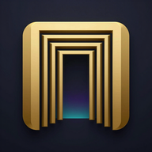
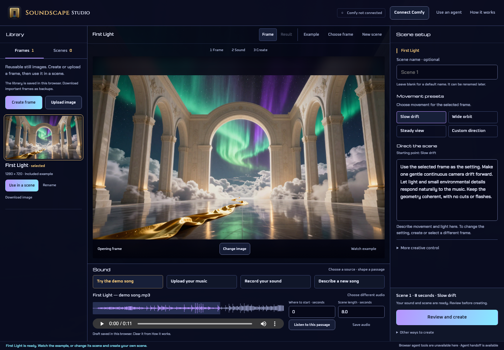

# Soundscape Studio

**Give your music a world.**

An open-source local studio for making short music-driven scenes with Comfy. Create or choose a reusable **frame**, add **sound**, direct the movement, and review the resulting **scene**. Download it as a video.

**Status: experimental v0.1 source release, with a real Comfy-generated demo.** The studio signs in to the user's Comfy account, submits approved runs, shows progress and retrieves results. It is a standalone mini app; an agent is optional. There is no bundled paid key or creator-funded public generation service.



[Download First Light, the eight-second demo (MP4)](https://github.com/Zuberverse/soundscape-studio/raw/refs/heads/main/demo/world.mp4) · [Setup help](docs/TROUBLESHOOTING.md) · [Contributing](CONTRIBUTING.md) · [Demo walkthrough guide](docs/DEMO.md)

## Run the studio

Requires Node.js 22 or newer (tested with Node 24), npm, and a modern browser with Web Audio and IndexedDB. You can explore the included demo without a Comfy account. Creating new media requires your own Comfy Cloud account with workflow execution access and credits.

```sh
git clone https://github.com/Zuberverse/soundscape-studio.git
cd soundscape-studio
npm ci
npm start
```

Open **http://127.0.0.1:4317**. Choose **Example** to watch First Light without generating anything. To try the studio, use the included frame and demo song, or bring your own media.

1. **Frame:** create one through Comfy, upload an image, or choose a saved frame in the library.
2. **Sound:** use the demo, upload music, record up to 30 seconds, or describe a song for MiniMax Music 3. Select a 2–16 second passage.
3. **Scene:** choose a movement preset or write a direction. Optionally name the scene; a default is supplied when blank.
4. **Create:** connect Comfy, review the sources, approve credit use and start a run. Start more while it works (up to four at once) and follow them under **Runs**. Watch and download each result on the stage. Rename it later without generating again.

The desktop workspace fits the window: library, central stage, full-height inspector and sound deck. Smaller screens switch between those panels. Prompt fields have fixed heights and scroll internally.

Cloud execution needs both execution access and credits in the workspace selected at sign-in. A connected badge confirms sign-in; it does not verify a plan or credit balance. New music, frames and scenes use that workspace's credits. The included demo plays locally without a generation charge.

## Your compute and your files

Run one local server per person. This is a single-user local app, not a hosted multi-user service. OAuth credentials remain in server memory and are never sent to the page. Restarting the server requires reconnecting. Only the selected audio passage and frame are uploaded after scene approval; the original full track stays local. Descriptions and optional lyrics are sent to Comfy when you approve creating a frame or song.

Browser drafts, frame images and names use local browser storage. Run recovery records and downloaded results use the ignored `local/` directory. Browser site-data removal clears its library; local file deletion does not delete media already uploaded to Comfy. Download important media as backups.

All generated images, music, video and creative finishing run through inspectable Comfy workflows. The current path uses Z-Image-Turbo, MiniMax Music 3 and native LTX-2.3 audio-conditioned generation with Comfy finishing. Local self-hosted Comfy is not integrated. Execution has been verified with one development account; independent recipient billing remains an open acceptance check. Publishing this experimental source does not certify a hosted or multi-user service. See [delivery and costs](docs/DELIVERY-AND-COSTS.md).

## Use an agent, or use Comfy directly

**Use an agent** copies a brief for Codex or Claude with the current frame, scene name, direction and timing. Copying it grants no spending permission. There is no required Soundscape plugin.

Experimental WebMCP exposes 14 browser tools to inspect and prepare the studio, including frame selection and scene naming. Tools can open reviews; they cannot submit paid generation or start the microphone. The clipboard handoff works when the browser has no WebMCP support. See [agent interface](docs/WEBMCP.md).

**Other ways to create** exports a prepared native Comfy workflow or portable scene recipe. Import the workflow into your own Comfy workspace and supply the matching source files there. Native microphone variants and the MiniMax song workflow are included.

## Proof and limits

First Light is an original Comfy-generated image, song and eight-second scene: 1280 × 704 at 24 fps, with the original musical passage preserved through Comfy finishing. The actual integrated native app and the local studio's sign-in → submit → result path were exercised. No seamless-loop or exact generative beat-sync claim is made.

See [implementation evidence](docs/IMPLEMENTATION.md), [demo provenance](demo/README.md), [development](docs/DEVELOPMENT.md), [design](DESIGN.md), [specification](SPEC.md) and [release plan](PLAN.md). The [issue tracker](https://github.com/Zuberverse/soundscape-studio/issues) owns unresolved release work. No hosted service or competition submission is live.

## Development

```sh
npm test
npx playwright install chromium
# Keep npm start running in another terminal:
npm run test:e2e
```

Browser tests mock generation and use a synthetic microphone; they spend no Comfy credits. See [development](docs/DEVELOPMENT.md) for workflow regeneration and the tested environment.

## Open source

Original code and documentation use [MIT](LICENSE), including commercial use. A future paid edition, support offering or hosted service is possible; none is currently offered. External models, dependencies and media retain their terms; see [notices](THIRD_PARTY_NOTICES.md) and [commercial policy](docs/OPEN-SOURCE.md).

Soundscape Studio is an independent project by Zuberant, separate from the OpenSoundscape bioacoustics library. It is not an official Comfy, LTX or Higgsfield product.
