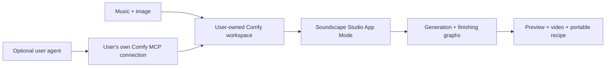

# Proposed architecture

**State:** design only, November 2, 2026. No component below is implemented.

## Recommended first shape

Build a **Comfy App Mode interface over reusable Comfy workflows**, running in the user's own workspace or a supported Comfy installation they control. No separate agent is required. Add an optional companion skill/plugin over the user's own MCP connection after the workflow works. A custom studio UI is a later option if native controls obstruct the creative experience.

There is no maintainer-funded public inference endpoint, shared workspace invitation or bundled credential. See [delivery and costs](DELIVERY-AND-COSTS.md) for the cost contract. A shared app link conveys a workflow; it must not convey authority to spend the creator's credits.

## Components and sequence

| Component | Responsibility | First implementation target |
|---|---|---|
| App Mode configuration | Clear music/image inputs, timing fields, world/motion controls, outputs | Native Comfy interface; verify available controls |
| Music preparation | Trim, audio preview, timing proposals and manual correction | Supported Comfy nodes; local analysis allowed when needed |
| World score | Source references, excerpt, direction, prompt and intentional timing | Versioned portable recipe; editable controls |
| Generation graph | Generate video conditioned on music and an optional opening image | Official LTX candidate graph or disclosed Comfy partner route |
| Finishing graph | Exact trim, restrained effects when supported, loop treatment and SaveVideo | Verified Comfy nodes on the selected host |
| Project/take record | Inputs, versions, job IDs, settings and measured resources | User-owned workflow/assets plus a portable recipe |
| Optional agent companion | Help prepare direction and operate the same graphs | User-installed skill/plugin with their own existing Comfy MCP |

All generative music, images and video use Comfy. Local analysis and QA create no alternative generation path. Creation and finishing graphs remain inspectable and record any partner nodes. No text model is required for the core App Mode route.

Comfy describes App Mode as a view over the same workflow/backend and queue, with selected inputs and outputs. This supports the first shape; it does not prove that its native controls can implement a custom waveform timeline. [Official App Mode introduction](https://blog.comfy.org/p/from-workflow-to-app-introducing)

## Generation routes

1. **Preferred capability:** native Comfy audio-conditioned LTX workflow. Host/model support must be established.
2. **Explicit alternative:** Comfy LTX partner A2V node. Still Comfy-contained but externally executed and potentially billed; excludes an Open Weights Only claim for that path.
3. **Creative fallback:** Comfy image/video generation with music-timed finishing, honestly labeled. It must not be called native audio conditioning.

These are candidates, not automatic fallbacks. No direct LTX, Higgsfield, fal or other provider-generation SDK belongs in the creation path.

## Proposed data contracts

These are design fields, not shipped schemas.

| Record | Essential fields |
|---|---|
| Source asset | ID, content hash, relative reference, media type, duration/dimensions and rights note |
| Music analysis | Algorithm/version, sample rate/time origin, proposed beats, energy curve, user corrections and uncertainty |
| World score | Schema version, source IDs, excerpt start/duration, world direction, prompt, intentional events, controls and seed |
| Take | Score revision, backend type, workflow hash, model/node versions, job ID, state, measured resources and output references |
| Export recipe | Executed API graph, optional editable authoring graph, relative asset references/hashes, finishing method, fps/duration and notices |

The audio sample clock owns excerpt timing. Convert to a fixed output-frame timebase explicitly. A model frame grid may require extra generated frames; finishing trims to the target without stretching the music. Proposed beats remain separate from user-accepted events.

Recipes omit credentials, absolute paths, account IDs, signed URLs and unnecessary private filenames. Model/hardware/service variation means replayable inputs do not guarantee identical pixels.

## State and recovery

Use native job identity and state first. For any companion or later custom interface, persist submission intent, then the returned job ID immediately. Reconnect to that job. An ambiguous submission without an ID requires reconciliation rather than a new paid submission. Finishing retries should reuse the successful generation.

The official SDK documents duplicate-key rejection and recovery by known job ID; a duplicate submit is not an assumed replay. Progress streams do not replace terminal job state. [Comfy SDK submission contract](https://docs.comfy.org/development/api-development/sdks#retrying-a-submit-the-idempotency-key)

## Media and privacy

Upload only the selected excerpt, image and necessary settings after explicit user action. Keep the full source track local when trimming before upload is supported. If the initial native flow uploads a full input first, disclose that difference and offer a pretrimmed-file path.

Do not publish user inputs, prompts or output links automatically. Validate decoded dimensions/duration and file types. Preserve original assets. Separate local deletion from provider retention; deleting a local recipe is not proof that remote media is erased.

## Optional custom interface

If App Mode cannot support useful excerpt editing or take comparison, evaluate a local TypeScript/React interface and narrow Python coordinator. It would operate the user's Comfy target and keep keys service-side. The SDK's Cloud, deployment and self-hosted proxy surfaces must be checked individually; do not assume a raw local Comfy endpoint implements v2. [Comfy SDK guide](https://docs.comfy.org/development/api-development/sdks)

No package manager, framework version, coordinator, database or executable manifest is selected in this foundation. A local custom interface would not itself require a user's agent. A paid hosted service would need a separate tenancy, billing and operational design.
