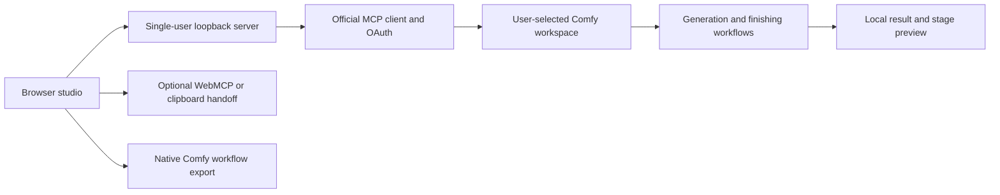

# Architecture

**As of:** November 2, 2026. Implemented local v0.1; see [verification](IMPLEMENTATION.md).

## Source boundaries

| Source | Responsibility |
|---|---|
| `studio/index.html`, `styles.css`, `studio-layout.mjs` | Accessible controls and responsive viewport workspace |
| `studio/app.mjs` | Audio/image preparation, connection state, review, polling and result interaction |
| `studio/library.mjs`, `collections.mjs` | Additive IndexedDB schema, reusable frames, scene metadata, names and local library |
| `studio/core.mjs` | Pure input validation, native graph parameters, portable recipe and PCM WAV encoding |
| `studio/webmcp.mjs` | Feature-detected experimental browser agent tools; preparation only |
| `server.mjs` | Loopback HTTP, session/Host/Origin checks, safe static files and action endpoints |
| `backend/bridge.mjs` | Official MCP client, supported OAuth flow, fixed Comfy service and response decoding |
| `backend/jobs.mjs` | One active run, source upload, saved workflow submission, recovery, cancellation and result collection |
| `workflows/`, `vendor/comfy/` | Inspectable native Comfy graphs and upstream attribution |

The runtime uses Node 22+ and `@modelcontextprotocol/client` 2.4.0. Plain browser modules need no bundler. Playwright 1.63.0 is test-only. Python 3 rebuilds movement and native microphone variants. No database service, text model or separate agent is required.

## Compute and authentication

All generative media and creative finishing use Comfy. Frame generation is Z-Image-Turbo, song generation is native MiniMax Music 3 through Comfy, and scenes use native LTX-2.3 audio/image conditioning plus Comfy finishing. There is no direct-provider fallback or maintainer key.

The server listens on 127.0.0.1. The official MCP client handles browser OAuth, state/PKCE and supported service discovery. Credentials live in process memory. The browser receives a local session cookie, connection status and redacted job records, never provider tokens. The Comfy account/workspace selected at sign-in is the executing account. Account isolation across two independent recipients is a separate release test, not established by this architecture alone.

This process serves one local operator. Multiple tabs share its connection and backend run history. It is not a multi-user hosted service or authorization boundary between people. Restarting clears authentication and requires reconnecting.

## Creation lifecycle

The browser validates media before generation: audio ≤50 MB and 2–300 seconds; image ≤20 MB and 25 megapixels. It decodes audio locally and creates a WAV containing only the chosen 2–16 second passage. After review and explicit credit consent, the backend creates a durable local job identity before uploading or submitting.

The backend prepares a native graph, uploads the scene's excerpt/image through the Comfy-provided fixed upload service, saves a new workflow in the user's workspace and submits once. It records the returned Cloud job ID immediately. Jobs progress through preparing, submitting, queued/running, downloading and completed, or retain failed/cancelled/review-required states. Refresh follows the known job. Concurrent starts share the owned active submission. A missing/ambiguous Cloud identity blocks blind paid resubmission. Cancellation is requested from Comfy and terminal state is checked afterward.

The native frame grid can exceed the requested musical duration. Finishing trims in Comfy to the intended output frame count without stretching the soundtrack. The verified eight-second result has matching audio/video duration. Model response to phrasing does not imply exact beat placement.

## Data and exports

IndexedDB schema 2 adds `frames` and `scenes` without removing the earlier `draft` store. Frames retain original bytes, content hash, name, source and dimensions. Named scenes retain recipe metadata and local output references. The selected frame ID is restored before content deduplication, preserving names for identical images. Local removal records prevent recovered generated frames reappearing unexpectedly.

The ignored `local/` tree holds input upload copies, atomic job-history JSON and downloaded results. It is not an encrypted vault or a provider deletion service. Browser source drafts support OAuth/refresh recovery; imported video URLs are session-only. Download important media before clearing browser or local data.

Portable recipes identify settings and source hashes without embedding media or credentials. The prepared native authoring workflow can be downloaded and imported into Comfy with the same source files. The saved executed workflow remains in the user's Comfy workspace; the app does not yet export a separate post-run API graph or re-import portable recipes automatically. Identical model pixels are not guaranteed.

## Agent surface

WebMCP feature detection prefers `document.modelContext`, then the older navigator variant. Its tools inspect choices, select frames, edit names/direction/timing and prepare reviews. Paid submission and microphone capture remain explicit UI actions. Unsupported browsers use the optional clipboard brief. [WEBMCP.md](WEBMCP.md) owns the tool contract and experimental proof boundary.
